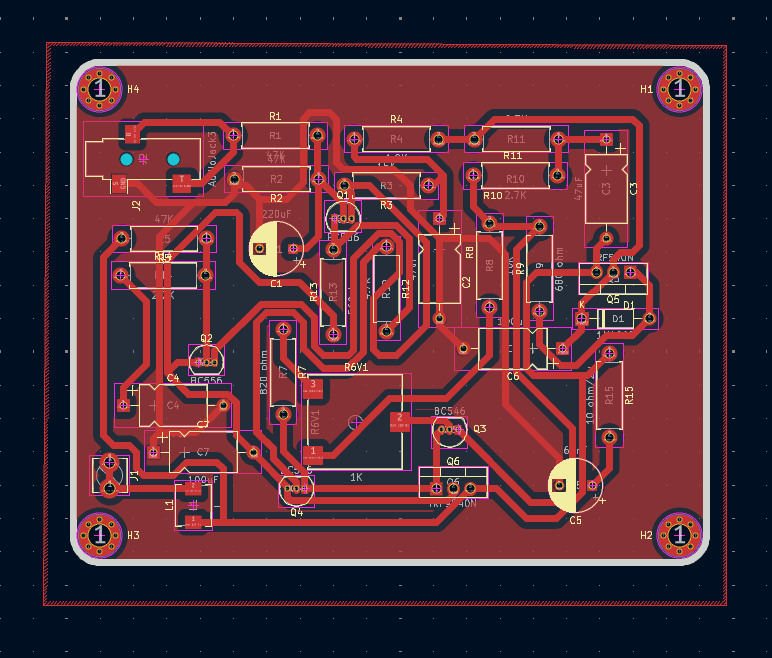

# Audio Amplifier PCB Design

A discrete-component audio amplifier PCB designed using **KiCad**. The project includes the electrical schematic, PCB layout, and a 3D visualization of the board and its component placement.

The circuit is designed to receive an audio signal through a 3.5 mm audio jack input and provide an amplified output through a separate output connector.

## Project Overview

The goal of this project is to design a printed circuit board (PCB) for an audio amplifier using discrete electronic components. The design process covers schematic capture, component placement, PCB routing, and 3D visualization.

**Project status:** Designed, not yet manufactured or tested.

## Features

- Audio signal input through a 3.5 mm audio jack.
- Amplified audio output through a separate connector.
- Discrete transistor-based amplifier circuitry.
- MOSFET output stage.
- PCB layout designed in KiCad.
- 3D visualization of component placement and board layout.
- Front and back copper layers, as configured in the PCB design.

## Design Previews

### 1. Electrical Schematic

The schematic illustrates the amplifier circuit, including its transistor stages, MOSFETs, resistors, capacitors, diode, power connections, and audio input/output interfaces.


### 2. PCB Layout and Component Placement

The PCB layout shows the copper routing, component footprints, connectors, and mounting holes.



### 3. 3D PCB View

The 3D render provides a visual representation of the board, including component placement, mounting holes, and overall layout.


*Replace the image paths above with the actual screenshot filenames committed to the repository.*

## Hardware Components

The design uses a combination of passive and active electronic components.

| Component | Purpose |
|---|---|
| Resistors | Biasing, current control, and circuit operation |
| Capacitors | Signal coupling, filtering, and power-supply decoupling |
| Diode | Protection or circuit biasing, depending on its role in the schematic |
| BC556 transistor | Small-signal transistor stage |
| BC546 transistors | Small-signal transistor stages |
| IRF540N MOSFET | N-channel MOSFET output stage |
| IRF9540N MOSFET | P-channel MOSFET output stage |
| Audio jack | Audio signal input |
| Screw terminal | Output connection |
| Mounting holes | Mechanical mounting of the PCB |

The component functions above describe their general roles. Actual operating conditions and circuit performance have not yet been verified through physical testing.

## Technical Details

| Parameter | Details |
|---|---|
| Project type | Audio amplifier PCB |
| Design software | KiCad |
| KiCad version | 10.0.7 |
| Design scope | Schematic, PCB layout, and 3D visualization |
| PCB copper | Front and back copper layers |
| Input interface | 3.5 mm audio jack |
| Output interface | Screw terminal |
| Main active components | BJTs and MOSFETs |
| Manufacturing status | Not manufactured |
| Testing status | Not tested |

The schematic shows positive and negative supply rails labeled `+36V` and `-36V`. These are schematic labels, not confirmation of a validated operating supply or tested performance.

Output power, frequency response, distortion, efficiency, and supported speaker impedance have not been specified.

## Repository Structure

The repository contains the KiCad design files and supporting project resources.

```text
audio-amplifier-01-pcb/
├── assistance/                  # Supporting screenshots or resources
├── .git/                        # Git repository metadata (local)
├── .history/                    # Local file history, if retained
├── fp-lib-table                 # Footprint library configuration
├── audio amplifier pcb.kicad_pcb # PCB layout
├── audio amplifier pcb.kicad_pro # KiCad project settings
├── audio amplifier pcb.kicad_sch # Electrical schematic
└── README.md                    # Project documentation
```

*The file tree is illustrative. Keep only filenames and folders that actually exist in your GitHub repository. The `.git` directory is normally local Git metadata and is not committed to GitHub.*

## Getting Started

To inspect the design locally:

1. Install [KiCad](https://www.kicad.org/).
2. Clone the repository:

   ```bash
   git clone https://github.com/ABDELBARI0/audio-amplifier-01-pcb.git
   ```

3. Open the KiCad project file (`.kicad_pro`).
4. Open the schematic editor to inspect the circuit.
5. Open the PCB editor to examine component placement and copper routing.
6. Use the 3D Viewer to inspect the board and component arrangement.

## Design Workflow

The project follows a typical PCB development workflow:

1. **Schematic capture:** Create the electrical circuit and establish component connections.
2. **Footprint assignment:** Associate schematic symbols with PCB footprints.
3. **PCB layout:** Arrange components and route electrical connections.
4. **3D visualization:** Review component placement and the overall board arrangement.
5. **Design verification:** Run electrical rule checks (ERC) and design rule checks (DRC) before fabrication.
6. **Future manufacturing and testing:** Fabricate the PCB, inspect the assembled circuit, and validate its electrical and audio performance.

The final verification, manufacturing, and testing stages remain future work.

## Future Improvements

- Complete electrical rule checking (ERC) and design rule checking (DRC).
- Verify component ratings and power-supply requirements.
- Generate Gerber and drill files for PCB fabrication.
- Manufacture and assemble the PCB.
- Perform safe initial power-up and electrical measurements.
- Test audio output quality, frequency response, and distortion.
- Document measured performance and any design revisions.

## Author

**GitHub:** [ABDELBARI0](https://github.com/ABDELBARI0)

**Project Repository:** [audio-amplifier-01-pcb](https://github.com/ABDELBARI0/audio-amplifier-01-pcb)

## License

No license has been specified yet. Add a license file if you intend to define how others may use, modify, or distribute this design.
